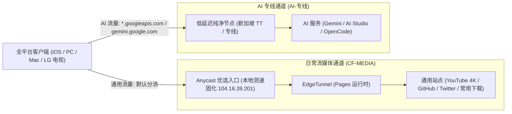

# Cloudflare Anycast 优选与双轨分流架构 (CF-MEDIA / AI-专线)

兼顾通用流媒体与下载的免费千兆极速，以及对风控敏感的 AI 业务高可用性。全平台（iOS、Windows、macOS、LG 电视）统一配置。

[简体中文](README.md) | [English](README_en.md)



## 为什么需要本项目

- **免费千兆流量与 AI 纯净出口兼得**。Cloudflare 机房 IP（ASN 13335）被 Google Gemini 严格封锁。本架构在客户端精准分离流量。99% 的大流量娱乐走完全免费的千兆 Anycast，AI 业务自动切换至纯净专线，彻底杜绝 400 报错与人机验证。
- **告别节点频繁横跳与 502**。停用无意义的海外机房 Actions 测速，固化本地真实网络筛选的高速 Anycast 入口。采用静态直连替代多节点轮询竞速，长连接极其稳固，杜绝断流与网关超时。
- **解决 YouTube 播放假死缓冲**。针对 WebSocket 隧道不支持 UDP 的特性，配置内置 QUIC（UDP 443）阻断规则。强制浏览器秒切高速 TCP（HTTP/2），彻底消除视频起播与进度条拖拽时的假死现象。
- **全生态全设备统一配置**。一套设计对齐所有设备：iPhone、iPad、Windows、Mac 以及客厅中的 LG webOS OLED 电视，真正做到一次调优、全屋共享。

## 客户端一键配置

### 1. Clash Verge Rev / FlClash (Windows / macOS)
1. 在客户端“订阅”页面导入你的 EdgeTunnel 订阅链接。
2. 在“扩展配置 (Merge)”中添加以下配置地址并保存激活：
   ```
   https://raw.githubusercontent.com/RealRayTan/edge-routing/main/clients/clash-verge.yaml
   ```
3. 客户端自动生成“日常流媒体”与“AI-专线”分组，并内嵌 QUIC 阻断与 YouTube 规则。

### 2. Shadowrocket (iOS)
1. 在小火箭“配置”页面点击“从 URL 添加”，输入以下地址并下载应用：
   ```
   https://raw.githubusercontent.com/RealRayTan/edge-routing/main/clients/shadowrocket.conf
   ```
2. 在首页确保“全局路由”设置为“配置”。
3. 首页自动展示两大专线分组，自动执行分流。

### 3. LG webOS 电视
与本项目仓库的 `104.16.39.201` 高吞吐节点完全统一。直接作为电视端 Alcyone 的主力接入点，保障电视海报抓取与 YouTube 4K 顺畅播放。

## 策略组设计

| 策略组名称 | 默认出口 | 承载业务与特性 |
|---|---|---|
| **`日常流媒体`** | `CF-MEDIA` | 负责 YouTube、Twitter/X、GitHub 及通用下载。千兆带宽，完全免费。 |
| **`AI-专线`** | `TT` / 独立专线 | 负责 Gemini 网页版、Google AI Studio 以及 OpenCode/Magpie 会话。纯净出口，零风控。 |

## 安全与隐私说明

- **零凭据暴露**。仓库中发布的 `clash-verge.yaml` 与 `shadowrocket.conf` 仅包含分流规则集与策略组结构，**完全不含任何节点信息、私密域名、UUID 密码或订阅 Token**。
- **无法单独作为代理连接**。他人仅下载这些配置文件无法连接到任何代理服务。客户端必须由使用者自行绑定并导入属于自己的节点订阅后方能生效。
- **公共 Anycast IP 说明**。`ip.txt` 中收录的 `104.16.39.201` 为 Cloudflare 官方公开广播的公共 CDN 边缘地址，并非任何人的私有服务器。缺少专属 VLESS 凭据时无法建立任何隧道连接。

## 验证与测试

本项目内置端到端链路健康自检脚本，确保发布节点具备完全的出站可用性：

```bash
# 运行单元测试（30 项核心断言全部通过）
python3 -m unittest discover -s tests -v

# 端到端链路可用性与分流检测
python3 scripts/verify_chain.py --ip 104.16.39.201
```
