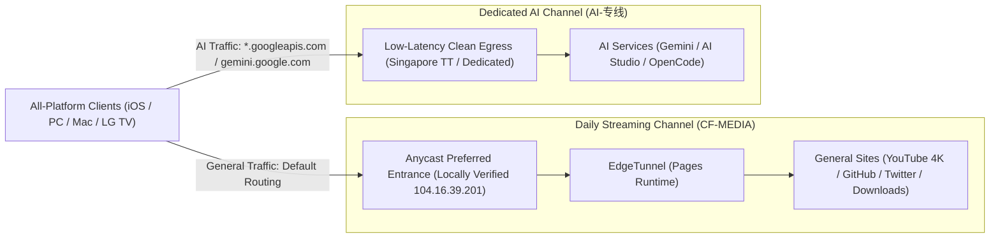

# Cloudflare Anycast Preferred & Dual-Track Routing Architecture (CF-MEDIA / AI-专线)

Combines unmetered gigabit speeds for general media and downloads with high availability for risk-sensitive AI workloads. Unified across iOS, Windows, macOS, and LG webOS TV.

[English](README_en.md) | [中文](README.md)



## Why This Architecture

- **Unmetered gigabit speeds and clean AI egress together**. Cloudflare data center IPs (ASN 13335) are strictly geo-blocked by Google Gemini. This architecture splits traffic cleanly at the client layer. Over 99% of high-volume traffic uses free gigabit Anycast, while AI traffic routes through clean residential egress to prevent HTTP 400 errors and CAPTCHAs.
- **No node flapping or 502 errors**. Eliminates ineffective automated scans in foreign data centers, replacing them with a locally benchmarked static Anycast entrance. Explicit static selection prevents continuous multi-node racing and keeps long-lived connections stable.
- **Zero YouTube buffering lockups**. Because WebSocket tunnels lack native UDP support, browser attempts to negotiate HTTP/3 (QUIC) cause buffering freezes. Built-in UDP 443 blocking forces browsers to immediately use fast TCP (HTTP/2), eliminating playback stalls.
- **Unified cross-device configuration**. One consistent design across all devices: iPhone, iPad, Windows, Mac, and the living room LG webOS OLED TV.

## One-Click Client Setup

### 1. Clash Verge Rev / FlClash (Windows / macOS)
1. Import your node subscription link in the client.
2. In **Script / Merge Extensions**, add the following URL and activate (CDN mirror recommended to bypass GitHub raw blocks):
   ```
   https://fastly.jsdelivr.net/gh/RealRayTan/edge-routing@main/clients/clash.yaml
   ```
   (Official Raw: `https://raw.githubusercontent.com/RealRayTan/edge-routing/main/clients/clash.yaml`)
3. The client automatically configures `日常流媒体` (Daily Streaming) and `AI-专线` (Dedicated AI) groups with built-in QUIC blocking.

### 2. Shadowrocket (iOS)
1. In the **Config** tab, tap **Add from URL**, paste the following address, and download:
   ```
   https://raw.githubusercontent.com/RealRayTan/edge-routing/main/clients/shadowrocket.conf
   ```
2. Set **Global Routing** to **Config** on the Home screen.
3. The client automatically splits daily media and AI traffic.

### 3. LG webOS TV
Fully aligned with the `104.16.39.201` high-throughput node in this repository. Serves as the primary endpoint for Alcyone on the TV, ensuring fast poster artwork fetching and uninterrupted 4K YouTube streaming.

## Routing Group Design

| Proxy Group | Default Egress | Handled Workloads & Characteristics |
|---|---|---|
| **`日常流媒体`** | `CF-MEDIA` | YouTube, Twitter/X, GitHub, and general downloads. Gigabit bandwidth, unmetered. |
| **`AI-专线`** | `TT` / Dedicated | Gemini web, Google AI Studio, and OpenCode/Magpie sessions. Clean egress without regional blocks. |

## Security & Privacy Assurance

- **Zero credential leakage**. The published `clash.yaml` and `shadowrocket.conf` contain routing rules and strategy groups only. **They contain no proxies, private domains, UUID secrets, or subscription tokens**.
- **Cannot function as standalone proxies**. Third parties downloading these files cannot connect to any proxy server. Clients require users to supply their own backend subscription.
- **Public Anycast IP**. The address `104.16.39.201` in `ip.txt` is an official public Cloudflare CDN Anycast endpoint, not a private server. Without valid VLESS credentials, no tunnel can be established.

## Verification and Testing

This project includes end-to-end health checking tools to ensure all published endpoints provide working outbound connectivity:

```bash
# Run unit tests (30 core assertions passing)
python3 -m unittest discover -s tests -v

# End-to-end chain verification and routing check
python3 scripts/verify_chain.py --ip 104.16.39.201
```
