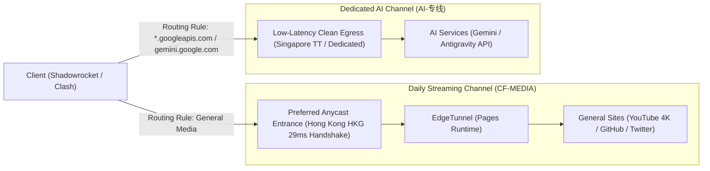

# Cloudflare Anycast Preferred Entrance & Dual-Track Egress Architecture (CF-MEDIA / CF-AI)

[English](README_en.md) | [中文](README.md)

This project maintains Cloudflare preferred Anycast entrances and client routing rules. By decoupling high-bandwidth general media traffic from sensitive AI traffic at the client layer, this architecture delivers ultra-low latency for routine browsing while guaranteeing reliable reachability for AI services (Gemini, Google, and OpenCode Magpie).



## Core Architectural Concepts

### 1. Complete Decoupling of Traffic Channels
- **`CF-MEDIA` (Main Channel for Streaming & Routine Browsing)**:
  Connects through an Anycast entrance with a 29ms local handshake to Cloudflare Hong Kong (`104.19.42.1`) and routes directly via EdgeTunnel hosted on Cloudflare Pages. It delivers unmetered, gigabit-speed bandwidth for over 99% of daily traffic (YouTube 4K, Twitter/X, GitHub, software downloads).
- **`AI-专线` (Dedicated AI Channel)**:
  Google Gemini and Google Cloud Code / Antigravity APIs strictly block cloud data center IP ranges (such as Cloudflare ASN 13335) with `User location is not supported`. This architecture uses a dedicated low-latency node (such as Singapore TT) to handle AI traffic, providing clean residential/personal egress to prevent HTTP 400 errors and regional lockouts.

### 2. Eliminating Remote Scans and Node Jitter
- **No Remote Automated Scans**: Scheduled cloud scans in foreign data centers do not reflect actual local network performance and cause subscription churn that interrupts long-lived connections. This repository maintains a verified, locally benchmarked static entrance instead.
- **Deterministic Routing Over Jittery Polling**: Using explicit `select` groups prevents the client from constantly polling multiple nodes, eliminating node hopping and HTTP 502 Bad Gateway timeouts.

## Repository Layout

- `ip.txt` and `global.txt`. Static, locally verified Anycast entrance (`104.19.42.1#CF-MEDIA`).
- `clients/shadowrocket.conf`. Shadowrocket configuration file with ad blocking, `日常流媒体` (daily streaming) and `AI-专线` (dedicated AI) routing groups.
- `clients/clash-verge.yaml`. Clash Verge Rev / FlClash override configuration with built-in QUIC blocking for YouTube.
- `clients/README.md`. Client import and setup guide.
- `scripts/verify_chain.py`. End-to-end verification script testing general and Gemini egress paths.
- `scripts/node_probe.py`. Local sing-box test runtime for throughput benchmarks.
- `scripts/update.py`. Local sampling script for Cloudflare official IPv4 CIDR ranges.
- `scripts/exit_lookup.py`. Queries IP2Location / IPPure APIs to verify exit country and ASN data.

## Client Setup (Shadowrocket)

1. Open Shadowrocket, go to the **Config** tab, select `clients/shadowrocket.conf`, and tap **Update from URL**.
2. On the Home screen, ensure **Global Routing** is set to **Config**.
3. Two dedicated proxy groups are displayed, managing automated traffic splitting:
   - **`日常流媒体`**: Routed to `CF-MEDIA` for streaming and general traffic.
   - **`AI-专线`**: Routed to `TT` for Gemini web interface and local OpenCode / Magpie sessions.

## Verification and Testing

Run the full unit test suite (all 30 assertions passing):

```bash
python3 -m unittest discover -s tests -v
```

Execute an end-to-end chain verification against an entrance IP:

```bash
python3 scripts/verify_chain.py --ip 104.19.42.1
```
